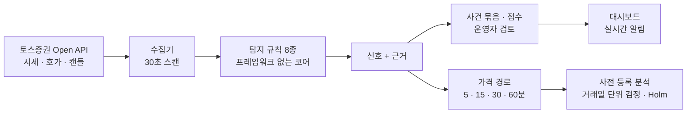

<div align="center">

# MarketGuard

**공개 시세만으로 한국 주식시장의 이상 징후를 잡고, 그 신호가 정말 맞는지까지 검증하는 감시 시스템**

[](https://github.com/mytrashcan/MarketGuard/actions/workflows/ci.yml)


[검증 현황](#검증-현황) · [작동 방식](#작동-방식) · [빠른 시작](#빠른-시작) · [분석 계획](docs/analysis-plan.md) · [API](docs/api.md) · [운영](docs/operations.md)

</div>

> [!NOTE]
> 토스증권 Open API의 **공개 시장 데이터만 읽습니다.** 주문·계좌 조회·이체 기능은 없으며, 탐지 결과는 투자 조언이나 규제기관 수준의 시장감시 판정이 아닙니다.

대부분의 이상 탐지 도구는 알림을 띄우는 데서 끝납니다. MarketGuard는 신호마다 근거를 남기고, 사건으로 묶어 검토하게 하고, **신호 뒤 실제 가격이 어떻게 움직였는지를 영구 기록해 규칙이 우연보다 나은지 통계로 판정**합니다. 판정 기준은 데이터를 보기 전에 [분석 계획](docs/analysis-plan.md)으로 고정했습니다.

## 검증 현황

| 규칙 | 30분 시장 대비 지속률 | 결론 |
|---|:---:|:---:|
| `PRICE_SPIKE` | — | 수집 전 |
| `PRICE_LIMIT` | — | 수집 전 |
| `ORDERBOOK_IMBALANCE` | — | 수집 전 |
| `VOLUME_SURGE` | — | 수집 전 |
| `PRICE_VOLUME_SURGE` | — | 수집 전 |

KRX 전 종목으로 정규장 20거래일 이상 운영한 뒤, 사전 등록한 계획(종목-일당 첫 신호, 거래일 단위 부호 뒤집기 검정, Holm 보정, 실질 효과 ≥ 55%)대로 계산한 결과를 **좋든 나쁘든** 이 표에 그대로 싣습니다. 아직 운영 데이터가 없으므로 지금은 어떤 규칙도 효과가 있다고 주장하지 않습니다.

## 작동 방식



- **탐지** — 8개 규칙이 시세·호가·캔들·투자경고·기관 수급을 평가합니다. 각 신호는 관측값·기준값·임계값·비교 범위·맥락 태그·추가 확인 항목을 함께 저장하고, 규칙 하나의 예외가 나머지를 멈추지 않습니다.
- **검토** — 같은 종목 신호를 사건으로 묶고 설명 가능한 0–100 관심도 점수를 붙입니다. 운영자는 상태·메모·이력으로 검토하고, 새 신호는 WebSocket으로 즉시 알립니다.
- **검증** — 신호 30분 뒤 결과를 시장·업종 대비로 판정하고 95% Wilson 구간과 함께 보여 줍니다. 별도로 5·15·30·60분 가격 경로를 영구 보존해, 시세가 지워진 뒤에도 측정 시점과 임계값을 바꿔 다시 분석할 수 있습니다.

## 탐지 규칙

| 규칙 | 판단 기준 |
|---|---|
| `PRICE_SPIKE` | 최근 가격 평균 대비 설정 비율 이상의 변동 |
| `PRICE_LIMIT` | 상·하한가 도달 또는 설정 비율 이내 근접 |
| `ORDERBOOK_IMBALANCE` | 총 매수/매도 잔량 비율이 임계값 이상 |
| `VOLUME_SURGE` | 최신 분봉 거래량이 직전 평균의 임계 배수 이상 |
| `PRICE_VOLUME_SURGE` | 가격 변동과 1분 거래량이 각각의 임계값을 동시에 초과 |
| `INVESTMENT_WARNING` | 현재 유효한 투자경고·위험·단기과열·정리매매 지정 |
| `INSTITUTIONAL_NET_BUY_SURGE` | KOSPI·KOSDAQ 기관 순매수가 최근 중앙값 배수와 최소 금액을 동시에 초과 |
| `INSTITUTIONAL_NET_SELL_SURGE` | KOSPI·KOSDAQ 기관 순매도가 최근 중앙값 배수와 최소 금액을 동시에 초과 |

계산식과 경계 조건은 [탐지 규칙 문서](docs/detection-rules.md)에 있습니다. 시장 캘린더 조회에 실패하면 지난 장 데이터로 오탐하지 않도록 장 마감으로 처리합니다.

## 신호 검증

| 지표 | 의미 |
|---|---|
| 방향 지속률 | 신호 방향(상승·매수 우위는 위, 하락·매도 우위는 아래)으로 가격이 움직인 비율. 50%는 우연과 같습니다. |
| 시장 대비 | 같은 구간 스캔 종목 변동률의 중앙값을 빼고 다시 판단합니다. 장 전체 흐름에 올라탄 신호를 걸러 냅니다. 기준 종목이 30개(`outcome.benchmark-minimum-samples`) 미만이면 계산하지 않습니다. |
| 업종 대비 | `OUTCOME_SECTORS_FILE`에 KRX 업종분류 CSV를 지정하면 같은 업종 다른 종목의 중앙값도 뺍니다. 같은 업종 표본이 5개 미만이면 계산하지 않습니다. |
| 강도별 | 임계값을 몇 배 넘었는지(×1–1.5, ×1.5–2, ×2+)로 나눠 봅니다. 강한 구간에서만 지속률이 높다면 임계값을 올릴 근거가 됩니다. |
| 가격 경로 | 신호 후 5·15·30·60분 가격과 같은 구간 시장·업종 중앙값을 판정 없이 영구 보존합니다. `GET /api/analytics/price-paths.csv`로 내려받아 [`scripts/analyze_price_paths.py`](scripts/analyze_price_paths.py)로 분석합니다. |

측정 구간에 시세가 없으면 `NO_PRICE_DATA`, 시장 전체 신호는 `NOT_APPLICABLE`로 남기고 결과를 추정해 채우지 않습니다. 통계 화면은 신뢰구간 전체가 50%보다 위면 "이어짐", 아래면 "되돌아감", 50%를 포함하면 "우연과 구분 안 됨"으로 표시하고 표본 10건 미만은 판단하지 않습니다. 시세 스냅샷 보존 기간(90분)이 가장 늦은 측정 시점보다 짧으면 앱이 기동하지 않습니다.

> [!IMPORTANT]
> 시연용 기본 종목(35개)으로는 시장·업종 대비가 거의 계산되지 않습니다. 규칙의 실효성은 [전 종목 운영 절차](docs/operations.md#signal-price-paths-and-full-universe-runs)를 따라 수집한 데이터로만 판단하세요.

## 빠른 시작

JDK 17과 Docker가 필요합니다.

```bash
./gradlew bootRun
```

대시보드는 `http://127.0.0.1:5050/`에 열립니다. 기본 프로파일은 loopback 바인딩, 수집기 꺼짐, 인증 꺼짐, 메모리 H2로 동작합니다. 실제 수집은 토스 자격 증명을 넣고 켭니다(하나라도 빠지면 기동이 실패합니다).

```bash
export TOSS_CLIENT_ID='...' TOSS_CLIENT_SECRET='...' COLLECTOR_ENABLED=true
./gradlew bootRun
```

**Docker Compose로 운영하기**

```bash
cp .env.example .env   # 필수 값을 채웁니다
docker compose up --build --wait
```

Compose는 DB 비밀번호 기본값 없음, PostgreSQL 포트 비공개, 앱 포트 loopback 전용, non-root·read-only 컨테이너, readiness 통과 후 healthy 처리를 강제합니다. 전 종목 운영은 `./data`에 KRX 종목·업종 CSV를 넣고 `.env`의 `SCAN_SYMBOLS_FILE`, `OUTCOME_SECTORS_FILE`을 지정합니다([data/README.md](data/README.md)).

혼자 쓰는 loopback 배포에서는 `MARKETGUARD_SECURITY_ENABLED=false`로 로그인 화면을 끌 수 있습니다. 이때도 사건 상태 변경과 메모 작성에는 `MARKETGUARD_OPERATOR_TOKEN`과 CSRF 토큰이 필요하며, 조회 API는 익명으로 열리므로 외부에 공개하면 안 됩니다. 자세한 조건은 [운영 문서](docs/operations.md)에 있습니다.

## 엔지니어링

| 영역 | 내용 |
|---|---|
| 아키텍처 | `detection` 코어는 Spring·JPA import가 없고, 의존 방향(`config/collector/dashboard/domain → application/detection`)을 아키텍처 테스트가 고정합니다. |
| 정확성 | 가격·비율은 모두 `BigDecimal`, 공식 시장 타임스탬프 보존, 영속적 원자 쿨다운, 낙관적 잠금으로 동시 검토 충돌 방지 |
| 외부 API 내성 | 타임아웃, 호출 그룹별 rate limit, 선택적 재시도와 `Retry-After`, circuit breaker |
| 보안 | HTTP Basic, loopback 쓰기 토큰, CSRF, strict WebSocket Origin, peer별 API rate limit, CSP·SRI, 입력 제한, 안전한 감사 로그 |
| 데이터 | PostgreSQL + Flyway 마이그레이션 8개, Hibernate schema validation, 대량 삭제·집계는 단일 쿼리 |
| 관측성 | Prometheus 지표, liveness/readiness, 규칙별 평가 결과·외부 호출 지표 |
| 품질 게이트 | 실제 PostgreSQL Testcontainers 테스트, line coverage 65%, CodeQL·dependency review, 이미지 취약점 스캔, Compose 스모크, 대시보드 접근성(WCAG AA 대비) 테스트 |

```bash
./gradlew clean check bootJar                      # Docker가 없으면 PostgreSQL 통합 테스트는 건너뛰지 않고 실패합니다
node --test src/test/js/*.test.mjs                 # 대시보드 스크립트 (Node 20.19+ 또는 22.12+)
python3 -m unittest discover -s scripts -p 'test_*.py'   # 분석 스크립트
./scripts/compose-smoke.sh                         # 이미지 빌드부터 Compose 기동까지
```

GitHub Actions와 Docker base image는 commit·digest로 고정했습니다.

<details>
<summary><b>API 엔드포인트</b></summary>

운영 프로파일은 probe를 제외한 모든 경로에 인증을 요구합니다. 계약 상세는 [api.md](docs/api.md)에 있습니다.

| 경로 | 설명 |
|---|---|
| `GET /api/prices/live` | watch list 현재 보드 |
| `GET /api/rankings?type=MARKET_TRADING_AMOUNT&limit=50` | 서버에 캐시된 토스 시장 랭킹, `limit=1..100` |
| `GET /api/stocks/{code}/candles?interval=1m&count=60` | 1분/일 캔들, `count=1..200` |
| `GET /api/stocks/{code}/context` | 가격·거래량 차트와 현재 가용 시장 맥락 |
| `GET /api/stocks/{code}/snapshots?limit=50` | 최근 시세 스냅샷 |
| `GET /api/anomalies?limit=50` | 최근 신호, `limit=1..200` |
| `GET /api/anomalies/count?since=...` | 주어진 시각 이후 신호 수와 심각 신호 수 |
| `GET /api/anomalies/{id}` | 구조화된 단일 신호 근거 |
| `GET /api/cases?...` | 사건 목록. 상태·규칙·심각도·종목·시간·점수 필터와 pagination |
| `GET /api/cases/{id}` | 점수 구성·타임라인·메모·상태 이력 |
| `PATCH /api/cases/{id}/status` | 버전 기반 상태 변경 |
| `POST /api/cases/{id}/notes` | 검토 메모 추가 |
| `GET /api/settings/detection` | 운영 중인 규칙별 임계값과 사건 묶음·점수 설정 |
| `GET /api/analytics/rules` | 규칙별 발생·기각·상위 검토·평균 검토 시간 |
| `GET /api/analytics/signals?days=14` | 날짜별(KST) 신호 수와 규칙별 사후 결과, `days=1..31` |
| `GET /api/analytics/price-paths.csv?days=31` | 신호 가격 경로 원자료 CSV, `days=1..366` |
| `GET /api/csrf` | 브라우저 쓰기 요청용 CSRF 토큰 |
| `GET /api/audit?limit=100` | 최근 감사 기록 |
| `GET /actuator/health/liveness`, `/readiness` | 프로세스 생존, 앱·DB 준비 상태 (익명 허용) |
| `GET /actuator/prometheus` | Prometheus 지표 |

잘못된 입력은 `400` JSON, 영구 upstream 오류는 `502`, 일시적 오류와 회로 차단은 `503`으로 응답합니다. 내부 예외·upstream body·자격 증명은 응답에 넣지 않습니다.

</details>

<details>
<summary><b>화면 수치의 의미</b></summary>

- 메인 화면 랭킹은 토스 시장 전체의 거래대금·거래량·상승·하락 순위이며, 순위와 가격·등락률·거래량·거래대금은 같은 응답의 값입니다.
- `/api/prices/live`의 "매수/매도"는 체결 비율이나 투자자별 순매수가 아니라 공개 호가창의 **미체결 잔량 비율**입니다. 장외·미제공·upstream 오류를 0과 구분합니다.
- 기관 수급 신호는 KOSPI·KOSDAQ **시장 전체 합계**입니다. 개별 종목이나 특정 기관의 매매가 아니며, 당일 값은 장 종료 전까지 잠정치입니다.

</details>

## 문서

| 주제 | 문서 |
|---|---|
| 신호 검증 분석 계획 (사전 등록) | [analysis-plan.md](docs/analysis-plan.md) |
| 운영·백업·지표·전 종목 운영 | [operations.md](docs/operations.md) |
| 설계와 계층 규칙 | [architecture.md](docs/architecture.md) |
| API 계약 | [api.md](docs/api.md) |
| 탐지 규칙 | [detection-rules.md](docs/detection-rules.md) |
| 복합 점수 · 검토 상태 전이 | [composite-score.md](docs/composite-score.md) · [case-workflow.md](docs/case-workflow.md) |
| 데이터 모델 | [data-model.md](docs/data-model.md) |
| 오탐과 한계 | [false-positives-and-limitations.md](docs/false-positives-and-limitations.md) |
| 신뢰 경계와 보안 통제 · 취약점 보고 | [threat-model.md](docs/threat-model.md) · [SECURITY.md](SECURITY.md) |
| 초기 감사 결과와 해소 상태 | [production-readiness.md](docs/review/production-readiness.md) |

## 제약 사항

- 토스는 client당 유효 토큰 하나만 허용하므로 같은 자격 증명으로는 앱 replica **1개만** 지원합니다. 내장 STOMP broker와 API rate limiter도 단일 프로세스 범위입니다.
- 알림 전송은 DB commit 이후 best-effort이며, 끊겼던 브라우저는 최근 신호 API로 복구합니다.
- 공개 배포는 TLS reverse proxy와 네트워크 ACL 뒤에서만 해야 합니다.
- 시장 지수·공시·뉴스·corporate action 데이터가 없어 해당 맥락은 만들어 내지 않고 `unavailable`로 표시합니다. 시장 대비 기준도 지수가 아니라 스캔 종목의 동일 가중 중앙값입니다.
- 신호와 감사 로그의 장기 보존 정책은 운영 환경의 요구에 맞춰 따로 정해야 합니다.
